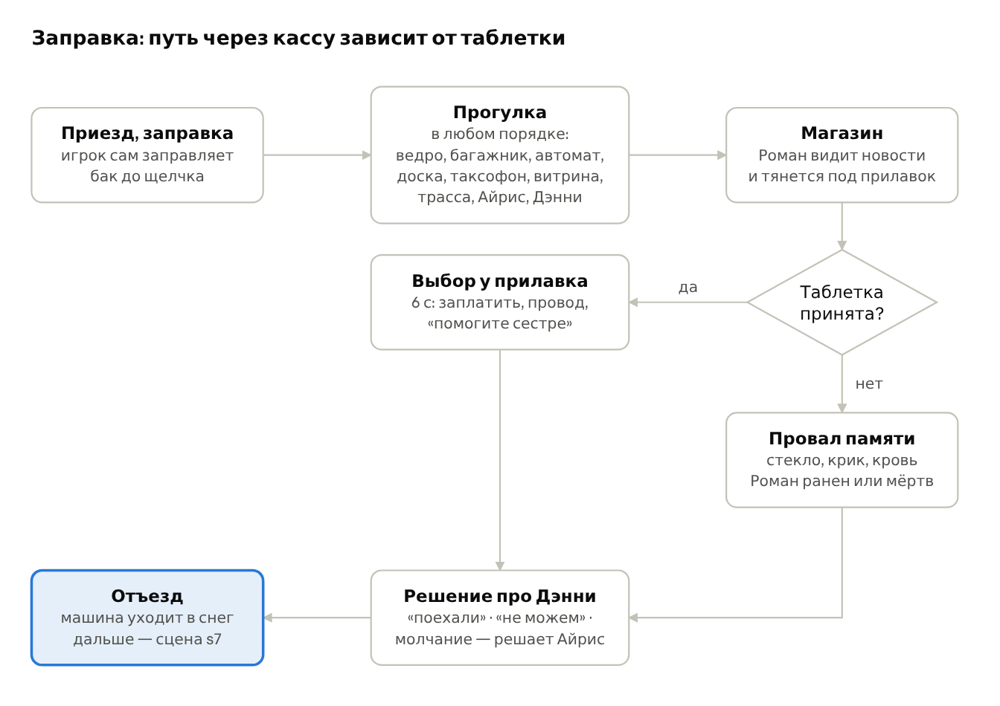

# Заправка «24» — постановочный лист эталонной сцены

4 ноября 2026 · живой документ: https://claude.ai/artifact/RemgiJ9rW2e9vfgNbDT7og (это копия, ред. 15); Word — `out/WhatTheLakeKeeps_station24_staging_sheet.docx`, не в git

**Согласовано редактором 4 ноября с уточнениями** (ответы и замечания — в конце листа). Лист передан в разработку; делается только эта сцена, остальные сцены и герои не переделываются до просмотра и утверждения видео.

## Паспорт сцены

Этот лист описывает заправку целиком: от приезда до отъезда. Все существующие реплики, выборы, флаги и условия сохранены дословно. Новое — движения, работа рук, ответ предметов, звук, планы камеры и действия игрока. Пометка **(новое)** — предложение, которого сейчас в игре нет; среди них только одна новая реплика.

- **Сцены в игре:** `s5` → прогулка `st24` → касса (конец `s5`) → `s5_calm` (`s5_pay`, `s5_cord`, `s5_help`) или `s5_lapse` → `s6` (`s6_a`, `s6_b` → `s6_a2` / `s6_leave`, `s6_c`) → `s6_end`.
- **Глава · место:** глава 1 · лесная заправка «24» на ночной трассе. Навес с колонками; магазин со стеклянной дверью, витриной и ступенькой; автомат с кофе и шоколадом; таксофон и доска объявлений под козырьком; у колонки — ведро со щёткой для стёкол; тёмный край площадки.
- **Время и свет:** 03:40, ночь, идёт снег. Красный неон «24» гудит и подмигивает; холодный белый свет навеса; тёплый свет магазина сквозь витрину; за краем площадки — темнота.
- **Кто в кадре:** Ной (19), Айрис (15), Дэнни (10), кассир Роман (за пятьдесят, усталый, грузный). Если опоздали — чёрный седан у края площадки, водителя не видно.
- **Вход:** после `s4` (в машине мигает лампа бензина, выбор про таблетки). **Выход:** `s6_end` → `s7`.
- **Руки Ноя на входе:** в засохшей крови — ладони и пальцы, под ногтями, манжета рукава (костяшки целые: разбитыми они станут только после провала). Это видно в каждом плане, пока он не вымоет руки.

### Длительность

| Эпизод | Обязательно | Длительность |
| --- | --- | --- |
| 1. Приезд и заправка | да | 70–90 с |
| 2. Руки в ведре со льдом | нет | 40–50 с |
| 3. Прогулка: 7 точек | нет | 15–40 с каждая, всего 3–4 мин |
| 4. Разговоры с Айрис и Дэнни | нет | 1,5–2,5 мин |
| 5. Магазин, Роман, выбор у прилавка | да | 60–90 с |
| 6. Провал памяти (если таблетку не принял) | по ветке | 45–60 с |
| 7. Решение про Дэнни и отъезд | да | 60–90 с |

Обязательный путь занимает около 5–6 минут, со всеми точками прогулки и разговорами — 12–15 минут.

### Состояния, которые меняют сцену

| Флаг | Откуда | Что меняется на заправке |
| --- | --- | --- |
| `pills` | принял таблетку в `s4` | гула в голове нет; на кассе — выбор `s5_calm`. Без таблетки — гул, реплика «Опять голова?», звон у автомата и провал `s5_lapse` |
| `late` | кювет или долгая остановка у оленя | чёрный седан у края площадки, его следы, окрик Айрис «Не ходи туда» |
| `deer` = 2 | добил оленя монтировкой | в багажнике сверху — монтировка в крови и шерсти |
| `trust` | доверие Айрис | её реплика: «Иди плати…» (2 и выше) или «Плати и сразу назад…» |
| `washed` | вымыл руки в ведре | Дэнни говорит «У тебя руки грязные» только без него; Роман видит грязные руки или «ладони чистые — под ногтями тёмное» |
| `shadow` | тёмные выборы раньше в главе | в провале Роман ранен (0) или мёртв (1 и больше) |
| `blanket`, `choco` | взял одеяло, достал батончик | в разговоре с Дэнни появляются «Укройся» и «Держи» |
| `danny_name` | спросил имя Дэнни | в `s6` — без пояснения, как его зовут |
| `lapse1` | провал на кассе | Дэнни боится Ноя в `s6` |

## Порядок эпизодов

Сцена идёт одной линией до кассы и расходится на два пути по тому, принял ли Ной таблетку в машине; оба пути сходятся на решении про Дэнни.

На прогулке игрок сам выбирает, куда подойти; чёрная машина появляется только при опоздании (`late`). В магазин можно войти в любой момент — это и есть выход из прогулки. Через 3 минуты без входа в магазин Айрис торопит: «Ной. Нам надо ехать».

## Эпизод 1 — приезд и заправка

**Сцена:** `s5` (начало) и вступление прогулки `st24` · **после:** `s4` · **дальше:** свободная прогулка · **кто:** Ной, Айрис, Дэнни; Роман в витрине; чёрный седан — если `late` · **длительность:** 70–90 с.

Шаги 1–6 — постановка без управления; с шага 7 игрок сам заправляет машину. Три нынешние подписи («Лесная заправка «24»…», «На ступеньке — мальчик…», «Ной заправляет машину») становятся кадрами и убираются; подписи «Щелчок. Колонка встаёт…» и «Гул в голове не стихает» — тоже.

1. **План: общий с трассы, камера стоит низко — 5 с.**
   - Машина Ноя сбавляет ход и сворачивает под навес. Дворник делает последний взмах, в свете фар — косой снег.
   - Неон «24» над магазином: цифра «4» гаснет на полсекунды и загорается с треском.
   - Звук: шины по снегу, мотор на холостых, гул и треск неона, ветер.
2. **План: салон, средний с заднего сиденья на обоих — 4 с.**
   - Ной ставит машину у колонки, правой рукой поворачивает ключ — мотор глохнет, приборы гаснут вместе с лампой бензина.
   - Айрис отстёгивает ремень: пряжка щёлкает, лента уезжает вверх. Она смотрит в боковое окно на ступеньку магазина.
   - Звук: мотор затихает, остаётся гул вывески и тиканье остывающего двигателя.
3. **План: ступенька глазами Айрис, средний с лёгким наездом — 4 с.**
   - Дэнни сидит под козырьком: шапка до бровей, детская рация зажата коленями. Он складывает ладони лодочкой и дышит в них — пар уходит сквозь пальцы.
   - Поднимает глаза на машину и сразу опускает.
4. **План: средний у водительской двери — 5 с.**
   - Ной тянет ручку изнутри и толкает дверь плечом: она примёрзла и поддаётся с хрустом наледи на уплотнителе.
   - Один ботинок в снег, второй; он выпрямляется во весь рост, ёжится и поднимает воротник ребром ладони.
   - Руки в крови он держит чуть от себя, стараясь не касаться куртки. Дверь закрывает бедром.
   - Звук: хруст наледи, скрип снега под ботинками, хлопок двери. Пар изо рта у всех героев всю сцену на улице.
5. **План: ступенька; два плана через плечо, Айрис всегда слева в кадре, Дэнни справа — 20–25 с.**
   - Айрис выходит из машины, идёт к ступеньке, руки в карманах худи. Останавливается в шаге и садится рядом — не вплотную, на расстоянии ладони. Блокнот кладёт на колени.
   - В глубине кадра Ной у бака открывает лючок (см. шаг 7) — не в фокусе.
   - Айрис (мягко, тихо): «Ты чего тут один?» / “What are you doing out here all alone?”
   - Реакция: Дэнни смотрит на неё снизу, потом мимо неё — на Ноя у колонки.
   - Дэнни (тихо, старается не заплакать): «Мама сказала ждать. Она… уже долго.» / “Mom told me to wait. She’s been gone… a long time.”
   - Реакция: Айрис кивает и ни о чём больше не спрашивает, смотрит на пустую трассу. Дэнни крепче сжимает рацию обеими руками.
6. **Только если `late`. План: глазами Ноя, медленный наезд — 5 с.**
   - Ной оборачивается к краю площадки: в темноте стоит чёрный седан, фары выключены. На крыше — тонкий слой снега: машина приехала недавно.
   - За лобовым — тёмный силуэт водителя, он не двигается. Неон на секунду гаснет и загорается. Подпись про чёрную машину убирается: всё видно.
7. **Заправка — первое действие игрока. План: ¾ сзади-сбоку у бака, в глубине ступенька с детьми — 25–30 с.**
   1. Ной поддевает ногтем большого пальца край лючка на заднем крыле — лючок откидывается со щелчком. Свинчивает крышку тремя оборотами кисти, кладёт её на край лючка.
   2. Снимает пистолет с колонки правой рукой: ладонь обхватывает рукоять, указательный ложится на рычаг. Шланг разгибается и скребёт по бетону. На табло колонки загораются нули, внутри коротко гудит насос.
   3. Вставляет пистолет в горловину, левой рукой придерживает шланг.
   4. **Действие игрока:** удерживать кнопку действия — Ной жмёт рычаг, топливо идёт, литры и цена бегут на табло; отпустить — подача стоит. Бак наполняется за 6–8 с удержания, провала нет.
   5. Пока идёт топливо, Ной смотрит на свою руку на рукояти: кровь тёмная, в трещинах кожи. Он перехватывает пистолет пальцами, чтобы ладонь не касалась рукояти.
   6. Если таблетку не принял: гул нарастает, края кадра пульсируют в такт сердцу; Ной прижимает основание ладони к виску и зажмуривается.
   7. Щелчок отсечки: пистолет дёргается в руке, табло замирает (например, 41,6 л). Ной вынимает пистолет — капля бензина падает в снег; вешает его на колонку, закручивает крышку до трёх щелчков и захлопывает лючок ладонью.
   - Звук: щелчок лючка, треск храповика крышки, гул насоса, шум топлива в горловине, тиканье счётчика, щелчок отсечки, лязг держателя.
8. **Управление у игрока.** Камера уходит за правое плечо Ноя. Подсказка интерфейса «Заплатить — в магазине» / “Pay inside” (сейчас это подпись). В магазине за витриной виден Роман у телевизора.

## Эпизод 2 — руки в ведре со льдом

**Точка прогулки:** `bucket` — «Отмыть руки» / “Wash your hands” · **где:** у островка колонки — ведро с водой для мытья стёкол и щёткой-скребком; раковины и крана нет · **кто:** Ной; в ответ — Айрис и Дэнни на ступеньке · **ставит:** `washed` · **длительность:** 40–50 с.

Все пять нынешних подписей точки становятся кадрами и убираются; смысл каждой сохранён в шагах ниже.

1. **Подход. План: за плечом, затем ¾ сверху на ведро — 3 с.**
   - Ведро стоит у островка: помятое, с налипшим снегом по краю. В нём наклонно вмёрзла щётка-скребок для стёкол.
   - Вода синяя (омыватель), сверху — тонкий лёд с узором инея; в нём отражаются красный неон и белый свет навеса.
2. **Присед и щётка. План: средний сбоку — 4 с.**
   - Ной приседает на носки, пола куртки касается снега.
   - Берёт ручку щётки и тянет: с первого раза не идёт, со второго вырывается с сухим треском и коркой льда на резине. Кладёт щётку поперёк края островка.
3. **Лёд — действие игрока. План: крупно, ведро сверху — 4–6 с.**
   - **Действие игрока:** подсказка «Разбить лёд», два нажатия.
   - Первое нажатие: Ной бьёт по льду ребром кулака — глухой стук, по льду расходится белая звезда трещин, но лёд держит.
   - Второе нажатие: удар сильнее — лёд лопается на 4–5 пластин, те накреняются и уходят краями под воду. Синяя вода выходит поверх, брызги мочат манжету.
   - Если игрок не нажимает 3 с, Ной разбивает лёд сам: провала нет.
   - Звук: глухой стук → хруст и треск → плеск; пластины льда звякают о стенки ведра.
4. **Руки в воду. План: крупно сверху — 4 с.**
   - Кончиками пальцев Ной отодвигает пластины к стенке. Одной рукой подтягивает рукав другой, потом опускает обе руки — сначала до запястий, потом глубже, манжеты намокают.
   - Реакция тела: резкий вдох сквозь сжатые зубы, плечи дёргаются вверх, клуб пара изо рта. Он не вынимает рук — холод до локтей.
5. **Мытьё. План: крупно руки в воде, потом лицо Ноя — 8–10 с.**
   - Ладонь о ладонь, потом тыльные стороны кистей. Ногтем большого пальца он выскребает под ногтями другой руки, поливает пригоршней запястья.
   - От рук в синей воде расходятся розовые разводы, вода становится розово-фиолетовой; пластины льда покачиваются.
   - Лицо: челюсть сжата, взгляд не отрывается от воды.
   - Звук: плеск, звяканье льда, короткое дыхание через нос, гул неона.
6. **Осмотр рук. План: крупно руки под светом навеса — 4 с.**
   - Он поднимает руки из воды и поворачивает их ладонями вверх и обратно: ладони чистые и красные от холода, пальцы не сгибаются.
   - Под ногтями и на манжете осталось бурое. Он трёт манжету большим пальцем — не отходит.
7. **Реакция Айрис. План: через плечо Айрис со ступеньки на Ноя у ведра — 3–4 с.**
   - Айрис смотрит на него. Дэнни рядом тоже смотрит — на руки Ноя.
   - Айрис первой отводит глаза и лёгким касанием плеча разворачивает Дэнни к себе. Ничего не говорит.
8. **Завершение. План: средний, затем снова за плечом — 4 с.**
   - Ной стряхивает воду с рук — капли пробивают в снегу маленькие дырки. Вытирает ладони о джинсы, дышит в кулаки.
   - Встаёт, опершись рукой о край островка. Ставится `washed`.
   - После этого вода в ведре остаётся розовой, с обломками льда, щётка лежит на краю — так же в провале памяти и при отъезде.

**Если руки не вымыты:** Дэнни говорит «У тебя руки грязные» (эпизод 4), а Роман видит руки в крови (эпизод 5). Так в игре уже сейчас.

## Эпизод 3 — прогулка: семь точек

Все точки необязательные и идут в любом порядке. У каждой свой план в ¾ с глубиной; где можно, в глубине кадра видны Айрис и Дэнни на ступеньке. Подписи-описания становятся кадрами; остаются только мысли Ноя — они помечены ниже.

### Багажник — «Открыть багажник» / “Open the trunk” (`trunk`, 20–25 с)

1. Ной встаёт у заднего бампера, вставляет ключ в замок крышки и поворачивает. Замок отщёлкивается, крышка приподнимается на палец. Он поднимает её двумя руками за край, со стекла крышки съезжает пласт снега. Загорается тусклая жёлтая лампочка багажника.
2. **План: сверху в багажник, над плечом Ноя.** Отцовские удочки в потёртом чехле, металлический ящик с инструментами, под ним — свёрнутое клетчатое одеяло.
3. Если `deer` = 2: сверху брошена монтировка — бурые пятна, к ним прилипла шерсть. Рука Ноя останавливается над ней и не касается.
4. **Мысль Ноя (ремарка остаётся):** «Ной не помнит, чтобы отец хоть раз взял его на рыбалку.» / “Noah can’t remember his father ever taking him fishing.” На этой фразе он касается пальцами чехла удочек.
5. **Выбор (без таймера):**
   - «Взять одеяло» / “Take the blanket” → Ной приподнимает ящик одной рукой (инструменты гремят), другой вытягивает одеяло, один раз встряхивает и берёт под мышку. Ставится `blanket`; дальше Ной ходит с одеялом под левой рукой, пока не отдаст его.
   - «Закрыть» / “Close it” → он опускает крышку и дожимает двумя ладонями до щелчка замка.
6. Звук: замок, скрип петель, шорох снега, лязг ящика, шелест одеяла, хлопок крышки.

### Автомат — «Купить шоколадку» / “Buy a candy bar” (`vending`, 20–30 с)

1. Стекло автомата запотело по краям, внутри ряды батончиков на спиралях. Бело-голубой свет автомата ложится на лицо Ноя.
2. Ной достаёт монету из кармана джинсов замёрзшими пальцами и опускает в щель: слышно, как она скатывается внутри. Нажимает кнопку — спираль поворачивается на четверть и встаёт. Батончик висит на краю. Автомат проглотил монету — и ничего.
3. **Выбор (без таймера):**
   - «Ударить по стеклу» / “Hit the glass” → Ной бьёт открытой ладонью по стеклу рядом с батончиком (ладонью, а не кулаком, как сейчас). Стекло дрожит, батончик срывается и гулко падает в лоток. Ной нагибается, откидывает клапан лотка и достаёт батончик. Ставится `choco`.
     - Если таблетку не принял: в голове звенит громче удара — высокий звон, кадр на мгновение пересвечивается по краям, Ной замирает с рукой на стекле.
     - **План: отражение в стекле автомата.** За витриной магазина кассир поднимает голову от телевизора и смотрит на Ноя, потом снова на экран.
   - «Отойти» / “Walk away” → Ной постукивает пальцем по стеклу и отходит.
4. Звук: монета в щели, жужание моторчика спирали, шлепок ладони по стеклу, стук батончика в лотке, клапан.

### Доска объявлений — «Осмотреть доску» / “Look at the notice board” (`board`, 15–20 с)

1. Пробковая доска под козырьком, бумажки на кнопках шевелятся на ветру. **План: средний на доску, надписи читаются.** «Продам дрова»; «Пропала собака, рыжая, зовут Лиса» — с бахромкой из отрывных номеров, два уже оторваны.
2. Ной задевает пальцем загнувшийся угол старого плаката и расправляет его. **План: наезд на плакат:** выцветшие сосны, «Санаторий «Тихие сосны». Сон, тишина, сосновый воздух». Камера задерживается на названии на секунду дольше — это место главы 4. Угол плаката снова загибается, как только Ной убирает палец.
3. Звук: шелест бумаги на ветру.

### Таксофон — «Позвонить» / “Use the payphone” (`phone`, 20–25 с)

1. Таксофон под маленьким козырьком на стене. Ной снимает трубку с рычага, стальной шнур расправляется. Трубка ледяная: он вздрагивает, когда прижимает её к уху. Гудок есть.
2. **Выбор (без таймера):**
   - «Набрать домашний» / “Dial home” → **план: крупно палец на металлических кнопках.** Указательный набирает номер без заминки («пальцы сами набирают домашний номер» — показано), каждая кнопка пищит. Длинные гудки: пять, шесть — их слышно, на лице Ноя ничего не меняется. На седьмом он медленно опускает трубку. **Мысль Ноя (ремарка остаётся):** «Дома некому снять трубку.» / “There’s no one at home to pick up.” Ставится `phoned`.
   - «Повесить трубку» / “Hang up” → сразу вешает трубку.
3. Трубка ложится на рычаг с лязгом, внутри гремит вернувшаяся монета. Звук: гудок, писк кнопок, длинные гудки, лязг, монета.

### Витрина — «Заглянуть в витрину» / “Look through the window” (`window`, 15 с)

1. Ной подходит к стеклу вплотную, прикрывает глаза ладонью от света навеса. **План: сквозь стекло, отражение Ноя лежит поверх магазина.**
2. За стеклом — кассир у прилавка, синий свет телевизора мигает на его лице. Звука не слышно: на плане гаснет всё, кроме гула неона. На стекле от дыхания Ноя остаётся и тает пятно.

### Трасса — «Посмотреть на трассу» / “Look at the road” (`road`, 15–20 с)

1. Ной выходит к краю навеса, снег сразу ложится на плечи. Поворачивает голову влево, вправо. **План: его глазами:** трасса пустая в обе стороны, ветер гонит позёмок волнами и заметает следы их машины прямо в кадре.
2. Если `late`: рядом с их следами — вторые, свежие, они сворачивают к краю площадки. Камера ведёт по ним до чёрной машины.
3. Звук: ветер, шорох позёмка; гул неона остаётся за спиной, тише.

### Чёрная машина — «Присмотреться» / “Take a closer look” (`blackcar`, только если `late`, 15–20 с)

1. Когда Ной входит в зону у края площадки, Айрис встаёт со ступеньки и делает шаг за ним. Айрис (резко, испуганно): «Ной! Не ходи туда.» / “Noah! Don’t go over there.” Ной останавливается.
2. Если игрок всё же подходит к точке: **план через плечо Ноя на машину, медленный наезд на лобовое.** Чёрный седан, мотор заглушен, стёкла тёмные, в них отражается красный неон. Водителя не видно.
3. **Мысль Ноя (ремарка остаётся):** «Водителя не видно. Но Ной уверен: на него смотрят.» / “He can’t see the driver. But Noah is sure he’s being watched.” На этой фразе Ной отступает на шаг, не отводя глаз.
4. Звук: потрескивание остывающего металла, ветер, сердцебиение Ноя в миксе под конец.

## Эпизод 4 — разговоры с Айрис и Дэнни

Оба разговора снимаются через плечо в обе стороны с одной стороны от линии взгляда, с реакцией слушающего на важных репликах. Глаза — на верхней трети кадра, субтитр не закрывает лиц. Все реплики — существующие, с голосом.

### Айрис — «Поговорить с Айрис» / “Talk to Iris” (`iris`, 20–30 с)

1. Ной подходит к ступеньке. Айрис рисует в блокноте на коленях и, услышав шаги, закрывает его ладонью. Дэнни подтягивает колени.
2. **План: через плечо Ноя сверху на Айрис** (он стоит, она сидит). Ной (тихо): «Ты как?» / “You okay?”
3. Айрис (коротко, не поднимая глаз): «Нормально.» / “Fine.” И сразу прячет блокнот под полу худи и прижимает локтем (подпись «Она прячет блокнот…» убирается).
4. **План: через плечо Айрис снизу на Ноя.** По доверию:
   - `trust` 2 и выше — Айрис (спокойно, кивает на Дэнни): «Иди плати. Я с ним посижу.» / “Go pay. I’ll sit with him.”
   - меньше 2 — Айрис (жёстко, смотрит прямо на него): «Плати и сразу назад. Ни с кем не говори.» / “Pay and come straight back. Don’t talk to anyone.”
   - Реакция: Дэнни переводит взгляд с неё на Ноя.
5. Если таблетку не принял: Ной прижимает основание ладони к виску, Айрис это замечает.
   - Айрис (тише, без упрёка): «Опять голова?» / “Your head again?”
   - Ной опускает руку и отводит глаза: «Пройдёт.» / “It’ll pass.”
   - Реакция: Айрис ещё секунду смотрит на него, потом поворачивается к Дэнни.

### Дэнни — «Поговорить с Дэнни» / “Talk to Danny” (`danny`, можно подходить несколько раз; 15–25 с на вариант)

1. Ной опускается на корточки перед Дэнни — глаза на уровне глаз мальчика, предплечья на коленях. **Планы: через плечо Ноя на Дэнни и через плечо Дэнни на Ноя; Айрис — на краю кадра слева.**
2. Если руки не вымыты, при первом подходе:
   - Дэнни (просто, по-детски, разглядывая его руки): «У тебя руки грязные.» / “Your hands are dirty.”
   - Ной смотрит на свои ладони, поворачивает их. Айрис поворачивает голову к Ною.
   - При следующем подходе Ной сразу прячет руки в карманы куртки (подпись убирается).
3. **Варианты разговора (без таймера):**
   - «Как тебя зовут?» / “What’s your name?”
     - Ной: «Как тебя зовут?» — Дэнни: «Дэнни. А ты?» / “Danny. You?” — Ной: «Ной.» / “Noah.”
     - Дэнни (оживляется, впервые почти улыбается): «Как в книжке. Про корабль и зверей.» / “Like in the book. With the boat and the animals.”
     - Реакция: Айрис тихо фыркает и отводит глаза; Ной не улыбается. Ставится `danny_name`.
   - «Что за рация?» / “What’s the walkie-talkie for?”
     - Дэнни: «Вторая у мамы. Она сказала: если что — нажми и говори.» / “Mom has the other one. She said: if anything happens, push and talk.”
     - **План: крупно рация.** Большой палец жмёт кнопку, загорается красный огонёк. Шипение.
     - Дэнни (в рацию, тихо): «Мама. Приём…» / “Mom. Over…” — пауза: только шипение, палец отпускает кнопку.
     - Дэнни (Ною, будто оправдываясь): «Она всегда сначала не отвечает.» / “She never answers the first time.”
     - Реакция: Ной и Айрис переглядываются над его шапкой (общий план троих).
   - «Где твоя мама?» / “Where’s your mom?”
     - Дэнни: «Сказала: жди тут, я быстро.» / “She said: wait here, I’ll be quick.”
     - **План: глазами Дэнни — пустая трасса в снегу.**
     - Дэнни (снова глядя на Ноя): «Тогда ещё было светло.» / “It was still light out.”
     - Реакция: рука Айрис на ступеньке придвигается к его руке, но не касается.
   - «Держи» / “Here” (если есть `choco`)
     - Ной: «Держи.» — протягивает батончик. Дэнни берёт его обеими руками, разглядывает и не ест: прячет во внутренний карман, прижимает ладонью и кивает — на потом (подпись убирается). Ставится `choco_given`.
   - «Укройся» / “Wrap up” (если есть `blanket`)
     - Ной: «Укройся.» — отдаёт одеяло Айрис. Она встряхивает его, закутывает Дэнни по плечи и подоткнувает край под подбородок. Плечи мальчика опускаются — он перестаёт дрожать (подпись убирается). Ставится `blanket_given`.
   - «Отойти» / “Step away” — при первом разе Дэнни: «Вы уедете?» / “Are you leaving?” — Ной (вставая, рука на колене): «Сначала заплачу.» / “I have to pay first.”
4. Звук эпизода: гул неона тише (голоса главнее), скрип снега при приседе, шипение рации, шорох одеяла и обёртки.

## Эпизод 5 — магазин: дверь, Роман, выбор у прилавка

**Сцена:** дверь `shop_door`, выход прогулки `pay`, конец `s5`, затем `s5_calm` или `s5_lapse` · **кто:** Ной, Роман; за витриной — Айрис и Дэнни на ступеньке · **длительность:** 60–90 с.

### Дверь — «Открыть дверь» / “Open the door”

1. Ной берётся за холодную металлическую ручку — ладонь и пальцы обхватывают её — и толкает. Дверь тяжёлая: он помогает плечом, створка уходит внутрь от его руки, а не сама.
2. Над дверью звякает колокольчик. Тёплый воздух: пар изо рта исчезает, снег на плечах начинает таять.
3. Дверь за спиной медленно закрывается доводчиком, колокольчик звякает ещё раз, тише.
4. **План: за плечом, магазин целиком.** Стеллажи с товаром в упаковках с этикетками: чипсы, сухари, консервы, моторное масло, антифриз. Гудит холодильник с напитками, над одним рядом мигает лампа дневного света. На мокром полу — только его следы.
5. **Действие игрока:** дойти до прилавка и нажать «Заплатить за бензин» / “Pay for the gas”. Дальше — постановка без управления.

### У прилавка (конец `s5`, 20–25 с)

1. **План: средний на Романа через плечо Ноя — 3 с.** Роман сидит на высоком табурете за прилавком, руки скрещены на животе, смотрит вверх — на телевизор на стене за спиной (подпись «Кассир Роман. За его спиной — телевизор» убирается).
2. **План: вставка — телевизор — 3 с.** Школьная фотография Ноя, красная плашка: «РАЗЫСКИВАЕТСЯ: НОЙ, 19 ЛЕТ», ниже «Убийство в доме у озера. Может быть опасен. С ним сестра, 15 лет», бегущая строка (текст уже есть в игре на RU и EN). Звук телевизора приглушён: голос диктора без слов.
3. **План: крупно Роман — 3 с.** Он переводит взгляд с экрана на Ноя и узнаёт: скрещённые руки расходятся, он медленно выпрямляется на табурете (подпись «Роман смотрит на экран. На Ноя» убирается).
4. **План: крупно руки Ноя на прилавке — 3 с.** Взгляд Романа опускается на руки:
   - если не вымыл — руки в засохшей крови;
   - если вымыл — ладони чистые, под ногтями тёмное (подписи убираются, всё видно в кадре).
   - Ной замечает взгляд и убирает руки с прилавка в карманы.
5. **План: низко, под прилавком — 3 с.** Правая рука Романа медленно уходит под прилавок — к полке, где стоит телефон с шнуром; пальцы ложатся на трубку. Глаза Романа не отрываются от Ноя (подпись «Медленно тянется под прилавок» убирается).
6. **Развилка по таблетке (как сейчас):** принял в `s4` → выбор ниже; не принял → эпизод 6, провал памяти.

### Выбор у прилавка (`s5_calm`, таймер 6 с — прямая опасность, остаётся)

**План выбора:** крупно лицо Ноя; на краю кадра рука Романа поднимает трубку. Звук: гудок в трубке Романа, гул холодильника.

1. **«Не надо. Я заплачу и уеду»** / “Don’t. I’ll pay and go” → `s5_pay`, ставится `police`.
   - Ной (тихо, ровно, показывая пустые ладони): «Не надо. Я заплачу и уеду.» / “Don’t. I’ll pay and go.”
   - Двумя пальцами достаёт из внутреннего кармана смятые купюры, кладёт на прилавок и разглаживает ладонью (подпись «Деньги на прилавке. Ной уходит» убирается).
   - Пятится к двери, не поворачиваясь спиной; Роман не вынимает руку из-под прилавка. Колокольчик.
   - **(новое)** План с улицы сквозь витрину: Роман подносит трубку к уху и набирает номер — видно, что полицию вызвали.
2. **«Вырвать провод телефона»** / “Rip out the phone cord” → `s5_cord`, ставятся `shadow` и `police_late`.
   - Ной перегибается через прилавок, хватает шнур кулаком и дёргает на себя: шнур вырывается из розетки в стене с треском, летят кусочки пластика.
   - Роман отшатывается: ладони вперёд, шаг назад в полку с сигаретами — пачки падают; на лице страх, он мотает головой (подпись убирается).
   - Ной бросает шнур на пол и уходит. Колокольчик.
3. **«Я не знаю, что я сделал. Помогите сестре»** / “I don’t know what I did. Help my sister” → `s5_help`, ставится `roman_ally`.
   - Ной (голос срывается): «Я не знаю, что я сделал. Помогите сестре.» / “I don’t know what I did. Help my sister.”
   - Роман долго молчит (план на его лицо 3 с; подпись убирается): рука под прилавком замирает, он смотрит сквозь витрину на Айрис и Дэнни на ступеньке.
   - Рука поднимается пустой и ложится на прилавок. Роман (устало, тихо): «Езжай, парень. Позвоню через десять минут.» / “Go, kid. I’ll make the call in ten minutes.”
   - Ной кивает и уходит. Колокольчик.
4. **Молчание (таймер истёк)** → `s5_pay`, как сейчас. **Вопрос редактору:** сейчас при молчании Ной всё равно произносит «Не надо. Я заплачу и уеду». Предлагаю: при молчании он без слов кладёт деньги и пятится к двери. Последствия те же (`police`).

## Эпизод 6 — провал памяти

**Сцена:** `s5_lapse` (только если таблетку в `s4` не принял) · **дальше:** `s6` · **кто:** Ной, Роман, Дэнни, Айрис · **ставит:** `roman_hurt` или `roman_dead`, `memory`, `lapse1` — как сейчас · **длительность:** 45–55 с.

Это первый провал в игре, он задаёт язык провалов: само событие мы не видим — только звук в темноте и пробуждение в другом месте с предметом в руках. Жестокость показываем только последствиями, коротко. Все нынешние подписи становятся кадрами и звуком; их смысл сохранён.

1. **План: крупно лицо Ноя — 3 с.** В ушах нарастает звон, звуки магазина уходят, края кадра пульсируют. Сквозь звон — Роман (настороженно, тихо, рука уже под прилавком): «Эй, парень…» / “Hey, kid…” Фокус соскальзывает с Романа на фотографию Ноя в телевизоре.
2. **Провал — 2–3 с.** Кадр «рвётся» и уходит в чёрный. В темноте — только звук: бьётся стекло, кричит ребёнок (голос Дэнни). На удар стекла — вспышка в 4 кадра: белая трещина бежит по стеклу. Подпись «Бьётся стекло. Кричит ребёнок» не нужна — её заменяет звук; для игроков с выключенным звуком она остаётся субтитром звука.
3. **Пробуждение. План: крупно руки на пистолете — 4 с.** Резкая склейка, звук возвращается разом: гул неона, ветер. Ной стоит у колонки и сжимает заправочный пистолет обеими руками, будто собрался заправляться. На табло — те же цифры, что после заправки: бак полный. Костяшки разбиты и в крови, капля стекает по рукояти. Дыхание частое, рваные клубы пара.
4. **План: его глазами — дверь магазина — 2,5 с.** Стеклянная дверь треснула звездой на высоте головы. Колокольчик над ней ещё качается — беззвучно.
5. **План: сквозь витрину — 3–3,5 с.** Роман на полу между прилавком и полкой, вокруг рассыпаны пачки сигарет:
   - `shadow` = 0: стонет (глухо, сквозь стекло), держится за голову обеими руками, ноги шевелятся;
   - `shadow` 1 и больше: не шевелится, под ним по мокрому полу растекается тёмное, глаза открыты и смотрят на дверь. План не затягиваем.
6. **План: ступенька — 3 с.** Дэнни смотрит на Ноя и не дышит: у него единственного нет пара изо рта, рация прижата к груди. Айрис уже стоит между ним и Ноем, рука чуть отведена назад — заслоняет мальчика.
7. **План: через плечо Ноя на Айрис — 2 с.** Айрис (тихо, жёстко, не подходя ближе, смотрит на его руки): «Садись. Быстро.» / “Get in. Now.”
8. **Вспышка памяти (как сейчас — только без таблетки) — 2 с.** Холодный синий свет: женская рука на досках мостков, мокрый рукав. Звук: плеск воды о доски. Резкая склейка назад, Ной моргает (подпись «Женская рука…» убирается — всё в кадре).
9. **План: средний у колонки — 3 с.** Ной разжимает пальцы: пистолет падает и повисает на шланге, качаясь. Он идёт к машине, не оглядываясь.

Разбитые костяшки остаются до конца главы; пистолет на шланге и трещина на двери видны при отъезде.

## Эпизод 7 — решение про Дэнни и отъезд

**Сцена:** `s6` → `s6_a` / `s6_b` (→ `s6_a2` / `s6_leave`) / `s6_c` → `s6_end` · **дальше:** `s7` · **кто:** Ной, Айрис, Дэнни; Роман в витрине · **длительность:** 60–90 с.

1. **Дети у машины. План: средний у задней двери — 5 с.**
   - Айрис подводит Дэнни к машине за руку; в другой руке у него рация. Ной подходит со стороны колонки.
   - Если `blanket_given` — Дэнни в отцовском одеяле; если `choco_given` — ладонь на кармане с батончиком.
   - Если имя не спрашивали (`danny_name` = 0): **(новое)** вместо подписи «Его зовут Дэнни — она уже успела спросить» Айрис говорит сама (коротко, будто защищая его): «Его Дэнни зовут.» / “His name’s Danny.”
2. **Выбор (`s6`, 8 с, как сейчас). План: через плечо Ноя на Айрис и Дэнни.** Дэнни смотрит снизу на Ноя, Айрис — прямо ему в глаза.
   - **«Поехали с нами»** / “Come with us” → `s6_a`:
     - Ной (негромко, тянется не к мальчику, а к двери): «Поехали с нами.» / “Come with us.” Открывает заднюю дверь за ручку и держит её.
     - Если был провал (`lapse1`): Дэнни в ужасе пятится, вырывает руку у Айрис, отступает в снег (выражение «страх»; подпись убирается). Айрис опускается перед ним, берёт за оба плеча (тихо, твёрдо, глядя в глаза): «Я с тобой. Он тебя не тронет.» / “I’m right here. He won’t hurt you.”
     - Дэнни садится назад: руки на дверной раме, колено на сиденье, влезает. Ной закрывает дверь осторожно, не хлопая (подпись «Дэнни садится назад» убирается). `danny`.
   - **«Мы не можем его взять»** / “We can’t take him” → `s6_b`:
     - Ной (тихо, не глядя на мальчика): «Мы не можем его взять.» / “We can’t take him.”
     - Айрис (жёстко, крепче сжимая руку Дэнни): «Никто за ним не придёт. Ты же видишь.» / “Nobody’s coming for him. You can see that.”
     - Реакция: Дэнни опускает глаза на рацию.
     - Второй выбор: сейчас 6 с; по правилу редактора (не паника, а тяжёлое решение) — **8 с**. План: крупно Ной у открытой двери.
       - «Ладно. Садись назад» / “Fine. Get in the back” → `s6_a2`: Ной (выдыхая): «Ладно. Садись назад.» — открывает дверь, Дэнни садится. Если `lapse1`: забивается в дальний угол — колени к груди, спиной к противоположной двери, как можно дальше от Ноя (подпись убирается). `danny`.
       - «Нет. Он остаётся» / “No. He stays” → `s6_leave`: Ной: «Нет. Он остаётся.» — крупно руки: Айрис медленно отпускает руку Дэнни, пальцы расходятся. Она садится в машину, не глядя на Ноя. Мальчик остаётся один под навесом (подпись убирается). `trust` −2, `danny_left`.
       - Молчание → `s6_c` (ниже).
   - **Молчание** → `s6_c`: Ной молчит и смотрит на трассу. Айрис сама открывает заднюю дверь, помогает Дэнни сесть и пристёгивает его ремнём (подписи «Ной молчит. Айрис решает сама» и «Она сажает мальчика назад» убираются). Если `lapse1` — Дэнни в дальнем углу. `danny`.
3. **Отъезд (`s6_end`). План: общий сбоку от навеса — 8–10 с.**
   - Ной садится за руль, дверь закрывается, мотор заводится, фары загораются.
   - Свет фар проходит по витрине. В ней — последствия кассы: Роман у телефона (`police`); Роман с оборванным шнуром в руке (`police_late`); Роман смотрит им вслед, трубка лежит (`roman_ally`); трещина на двери и Роман встаёт с пола (`roman_hurt`) или не встаёт (`roman_dead`). **(новое:** сейчас этих кадров нет, флаги уже есть\*\*)\*\*
   - Машина выезжает на трассу, цифра «4» на вывеске подмигивает, снег начинает заметать следы.
   - Если `danny_left`: под навесом остаётся маленькая фигура; тихо шипит его рация.
   - Дальше — `s7`.

## Звук, свет и камера сцены в целом

На заправке нет музыки: тишину держат неон, ветер и дыхание. Музыкальная нота звучит только дважды: низкий удар в провале и короткая тема на отъезде.

### Звук

- **Порядок громкости:** голоса → звуки действий → фон.
- **Фон на улице:** гул и треск неона, порывы ветра, шорох снега, гул ламп навеса. **В магазине:** холодильник, приглушённый телевизор, потрескивание мигающей лампы.
- **Шаги:** скрип по снегу, сухие по бетону под навесом, мокрые по полу магазина.
- **Гул в голове Ноя** (если таблетку не принял): низкий пульсирующий тон. Растёт на заправке и у автомата, на кассе переходит в звон перед провалом.
- **Дыхание Ноя** слышно в тихие моменты; в магазине оно учащается.
- **Новые звуки действий:**
  - лючок, крышка бака, пистолет, топливо, отсечка, держатель;
  - лёд (стук, треск, звяканье), плеск, трение ладоней;
  - багажник (ключ, замок, петли, ящик, одеяло);
  - автомат (монета, спираль, шлепок, лоток);
  - таксофон (гудок, кнопки, длинные гудки, рычаг, монета);
  - дверь магазина (ручка, доводчик, колокольчик дважды);
  - прилавок (деньги, шнур рвётся, пачки падают);
  - рация (кнопка, шипение);
  - провал (звон, стекло, крик, плеск воды о мостки);
  - машина (двери, ремни, двигатель).

### Свет

- **Холодный белый** — лампы навеса, с тенями от людей и колонок (сейчас тени только у двух ламп).
- **Красный неон «24»** — отсвет на снегу и на лицах в общих планах; цифра «4» подмигивает.
- **Тёплый свет магазина** сквозь витрину — пятно на снегу перед входом; внутри одна лампа мигает.
- **Мелкие источники:** бело-голубой автомат (на лице Ноя), жёлтая лампочка багажника, зелёные цифры табло колонки, синий свет телевизора на лице Романа.
- **Край площадки** — темнота; чёрная машина читается силуэтом и отражением неона.
- **Воздух:** пар изо рта у всех на улице (у Дэнни в провале — нет); снег оседает на плечах и шапках и тает в магазине; под навесом снег не идёт.

### Камера

- Прогулка — за правым плечом Ноя; у каждой точки — свой план в ¾ с глубиной.
- Разговоры — через плечо в обе стороны, линию взгляда не пересекаем; реакция слушающего на важных репликах.
- Глаза — на верхней трети, запас кадра в сторону взгляда; голова не стоит в центре.
- Медленные наезды — только на находки: Дэнни на ступеньке, чёрная машина, плакат санатория.
- Ручная камера с лёгкой тряской — только в провале.
- Склейки — на движении руки; субтитры не перекрывают лица и руки в кадрах действий.
- Подписи остаются для двух случаев: мысли Ноя и субтитры звука для тех, кто играет без звука.

## Что понадобится разработке и вопросы редактору

После согласования листа разработка делает только то, что нужно этой сцене, и только для героев заправки. Перед правкой моделей — проверка резервной копии от 4 ноября и её контрольных сумм.

| Что | Для чего | Сейчас в игре |
| --- | --- | --- |
| Движения Ноя | заправка (лючок, крышка, пистолет, рычаг), присед и удар по льду, мытьё рук, багажник двумя руками, монета и удар ладонью, набор номера, тяжёлая дверь, деньги на прилавок, рывок шнура, присесть к ребёнку, дверь машины | общие позы: присед, «открыть сундук», удар кулаком, трубка у уха |
| Движения Айрис | сесть на ступеньку, закрыть и спрятать блокнот, заслонить Дэнни, присесть к нему, закутать в одеяло, отпустить руку, посадить в машину и пристегнуть | сидит и стоит; жест «к груди» |
| Движения Дэнни | дышать в ладони, кнопка рации, батончик двумя руками, попятиться в страхе, залезть в машину, забиться в угол | сидит; жесты «кивок» и «к груди» |
| Движения Романа | смотреть телевизор, узнать, тянуться к телефону, поднять трубку, отшатнуться в полку, показать пустую руку, лежать на полу в двух вариантах | стоит; «открыть сундук», «нет» |
| Предметы | ведро с ломающимся льдом и розовеющей водой, щётка-скребок, пистолет со шлангом, лючок и крышка бака, табло колонки, таксофон с кнопками, автомат со спиралью и лотком, товар в упаковках, телефон под прилавком, трещина на двери, кровь на руках по стадиям (засохшая → чистые ладони и тёмное под ногтями → разбитые костяшки), задние двери седана на петлях (в модели отдельными сделаны только две двери, `door_l` и `door_r`) | пистолеты и шланги есть в модели, но не двигаются; товар — цветные бруски |
| Внешний вид героев сцены (решение редактора) | Айрис 1,50–1,55 м и стрижка прядями; Дэнни — волосы из-под шапки; Ной — куртка с фактурой кожи и складками; Роман — без изменений | Айрис 1,27 м, волосы «каской»; у Дэнни нет волос; куртка — ровный цвет |
| Камера | планы через плечо с сохранением оси, наезды, ручная камера в провале | крупный план говорящего, камера неподвижна |
| Звук | список в разделе «Звук» | есть щелчок пистолета, плеск, стук, колокольчик, шипение рации |

### Вопросы редактору

| № | Вопрос | Ответ | Уточнение редактора |
| --- | --- | --- | --- |
| 1 | Заправка — удерживать кнопку до щелчка отсечки, без провала? | Да | отпустил — подача стоит; показать руку, рычаг, шланг, цифры табло и момент отсечки |
| 2 | Лёд в ведре — два нажатия, без провала? | Да | первое — трещины, второе — пластины; 3 с бездействия — Ной разбивает сам; синяя вода, тонкий лёд, розовые разводы, мокрая манжета, реакция на холод |
| 3 | Молчание у прилавка — Ной молча кладёт деньги? | Да | достаёт деньги, кладёт, медленно отступает; последствия как у `s5_pay` (`police`); реплику не добавлять |
| 4 | Новая реплика Айрис «Его Дэнни зовут»? | Да | RU и EN, коротко и немного защитно; только если имя не спрашивали; ветку `danny_name` не менять |
| 5 | Второй выбор про Дэнни (`s6_b`): 6 → 8 с? | Да | остальные таймеры без согласования не менять |
| 6 | Кадры последствий в витрине при отъезде? | Да | строго по веткам: `police` — Роман звонит после ухода; `police_late` — шнур оборван, звонка не показывать; `roman_ally` — провожает взглядом; `roman_hurt` — приходит в себя; `roman_dead` — неподвижен; не объединять |
| 7 | Сначала дети на ступеньке, потом управление и заправка? | Да | приезд, остановка, выход Ноя, дети и их разговор — потом управление |

### Уточнения редактора перед разработкой

1. Шаги 1–6 эпизода 1 — без управления, с шага 7 игрок заправляет машину; момент передачи управления обозначить явно.
2. Длительность пересчитать по реальному прохождению после реализации, не по сумме секунд.
3. В точке с ведром — только ведро со стеклоомывающей жидкостью и тонким льдом: ни раковины, ни крана, ни другой ёмкости.
4. Кровь на руках — три состояния по порядку: засохшая → чистые ладони с тёмным под ногтями → разбитые костяшки после провала.
5. Предметы действительно взаимодействуют с руками и телом, а не появляются и исчезают.
6. Видео готовой сцены — полный эпизод от приезда до отъезда, с хотя бы одним вариантом ветвления и ведром.
