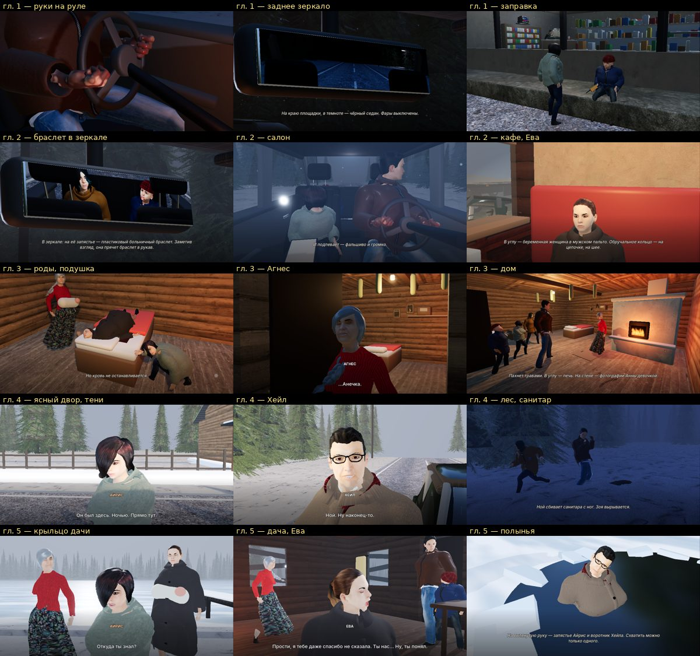
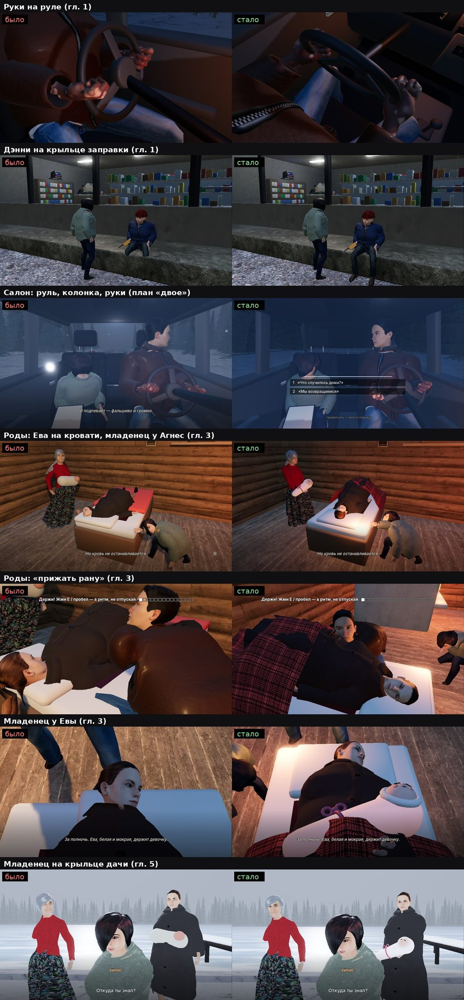

# WHAT THE LAKE KEEPS — итоговая проверка (главное ТЗ, 1–2 ноября)

Всё ниже запускалось в этом проходе; что не проверялось — сказано прямо. Облако: Godot 4.7.2, программная видеокарта
(lavapipe) — кадры и CPU честные, GPU — нет.

## 000. Посадка, жесты, вывески, дверь, фоновая загрузка, текстуры (4 ноября, вечер) — что проверено

| Проверка | Как | Итог |
|---|---|---|
| Маршруты в Godot | `story_tests.py` — все 36 маршрутов (`JOBS=3`) | **36/36**, все пять концовок (ice 3, mama 2, oblivion 2, shadow 4, witness 25); путь и флаги совпали, ошибок скриптов 0 |
| Посадка | `scripts/dev/seat_audit.gd` по маршрутам 01, 13d, 30 | без провалов в сиденья и без «висящих»; Виктор у сумки — ложное срабатывание самой проверки |
| Вывески | `scripts/dev/sign_audit.gd` | ни одна надпись не торчит над доской (было 5–60 мм, стало 1,5 мм), текст не шире доски |
| Жесты | `scripts/dev/gesture_shots.gd`, кадры спереди и сбоку | 31 жест по подписям; после жеста руки возвращаются как были |
| Дверь магазина | автопилот прогулки `st24` и `scripts/dev/door_shots.gd` | «Открыть дверь» → створка на петле, вход, «Заплатить за бензин» у прилавка |
| Текстуры героев | PSNR кожи против исходника | 36 → 52 дБ (BPTC на ПК, ASTC на телефоне) |
| Ходьба пальцем (телефон) | `scripts/dev/touch_walks.gd` — все 10 мест прогулок, палец слева в 4 стороны | до правки: заправка 0,76 м (первые 7 с вступления Ной не слушался) — НЕТ; после правки `explore.gd` — **10/10**, заправка 1,28 м, остальные 1,38–1,53 м |
| Маршруты после правки ходьбы | `story_tests.py` 01, 02, 04, 13c, 13d, 29 | **6/6**, все пять концовок; путь и флаги совпали, ошибок 0 (автопрогон прогулок не менялся) |
| Касания | `touch_test.gd`, окно 20:9 (1600×720) | **6/6** (джойстик, отпустил — стоит, палец справа — камера, «Осмотреть», пауза) |
| Управление / действия / экраны / сохранения | `--inputtest` (`c5_s1_hub`), `--qtetest`, `--uitest`, `--savetest A…E` | **10/10, 3/3, 7/7, 11/11** (первые три — и после правки ходьбы) |
| Сборка Windows 1.2 | экспорт с окном (shader baker) и прогон `--main-pack` по главе 1 | собирается — итог следующим коммитом |
| Сборка Android 1.2 | `--export-release "Android"`, подпись вручную (на диске не хватило места на копию при подписи) | APK 790 МБ, 1.2 / код 3: `apksigner verify` (v2 + v3), `zipalign -c -P 16 4`, `aapt2 dump badging` — ОК; в пакете только ASTC/ETC2 |
| `npm test`, e2e | основной проект | **73/73**, **52/52** |

Не проверялось: настоящие Windows и телефон (в облаке их нет), страница Adobe на телефоне (Adobe закрывает её от облачных
серверов), рывки при подгрузке глав на настоящем железе (фоновая загрузка включена, замера на устройствах нет).

## 00. «Грудь» у мужчин, шея Ноя, телефонный интерфейс (4 ноября, день) — что проверено

| Проверка | Как | Итог |
|---|---|---|
| Маршруты в Godot | `story_tests.py` на итоговом коде и новых моделях: 01, 02, 04, 05, 12, 13c, 13d, 17, 17b, 23, 29, 30 | **12/12**, все пять концовок; путь и флаги совпали, ошибок скриптов 0 |
| Управление / экраны / действия / сохранения | `--inputtest` (`c5_s1_hub`), `--uitest`, `--qtetest`, `--savetest A…E` | **10/10, 7/7, 3/3, 11/11** |
| Касания с телефонным интерфейсом | `touch_test.gd`, окно 20:9 (1600×720), без `override.cfg` | **5/5** |
| Телефонный интерфейс | `phone_shots.gd`: меню, настройки, реплика, выбор, пауза (20:9) | меню без «Выхода», плашки под палец; настройки в две колонки без прокрутки и без ПК-пунктов; ответы без цифр |
| «Грудь» на одежде | лучи спереди по готовым моделям (`profile.py`, вне репозитория) | жилет Романа: грудь 21,2 → 15,0 см вперёд, живот 19,6 — впереди груди (был «бюст»); причина — ось выкройки (`CLOTHING_QUALITY_AUDIT.md`, 4 ноября) |
| Шея Ноя | лучи спереди у основания шеи (`neckray.py`) | кожа впереди куртки: 2 строки сетки → 0 |
| Защипы («соски») на куртке | форма без текстур (`wardrobe --plain`), «лапласиан» вершин груди | звёздочки на груди исчезли; у куртки Ноя сглажено 67 мест, пальто Хейла — 115 |
| Все модели | гардероб 14 героев: спереди, сбоку, сзади, шея крупно; стоя, сидя, в шаге | дыр и кожи сквозь одежду не видно; осталось: край шарфа Хейла с зазубринами, высокий воротник парки Дэнни у подбородка |
| Сборки | `--export-release "Windows"` и `"Android"` | exe 754 МБ (один файл), APK 669 МБ (`apksigner verify` — ОК); на настоящих Windows/телефоне не запускались |
| `npm test`, e2e | основной проект | **73/73**, **52/52** |

## 0. Мастер-промпт редактора: главы 1–5 (3 ноября) — что проверено

Всё ниже запускалось 3 ноября на итоговом коде и данных; что не запускалось — сказано прямо.

| Проверка | Как | Итог |
|---|---|---|
| Сюжетные маршруты (симулятор) | `tools/lake/story_sim.py all` — 36 маршрутов (33 прежних + 17b, 29, 30) | прежние 33: те же концовки и сюжетные флаги, что до эпизодов; 17 — «горький» финал (шкатулку обошли), 17b — письмо вместо сгоревшего дневника (`proof` 2, «разоблачён»), 29 и 30 — с заездом в «Тихие сосны» (`proof` 3 и 5) |
| Маршруты в Godot | `tools/lake/story_tests.py` (без окна, автопилот): 01, 02, 04, 05, 12, 13c, 13d, 17, 17b, 23, 29, 30 — все пять концовок и новые эпизоды | **12/12**: путь, концовка и флаги совпали с симулятором, ошибок скриптов 0 |
| Проход по всем веткам | `tools/lake/story_audit.py check` — все выборы, провалы действий, точки прогулок и темы разговоров, модель присутствия | 5,3 млн состояний, **324/324 сцены**, тупиков 0, все пять концовок; «говорит тот, кого нет рядом» — **0**; упоминаний отсутствующего 36 — те же законные, что 1 ноября (пересказ «Ранее…», карточки, Хейл о заложниках, эпилог). Сам аудит исправлен: терял условие точки и темы (11 ложных находок), флаги прогулок всегда считал 0 (ветки «осмотрел точку» не проверялись), Еву в кафе видел только в сцене знакомства |
| Сохранения | `--inputtest --savetest A…E` подряд, общий `user://` | **11/11** (A 2/2, B 1/1, C 2/2, D 4/4, E 2/2); найдена и исправлена старая ошибка — запасная копия `.bak` не создавалась (`SAVE_SYSTEM_AUDIT.md`) |
| Повторы на экране | скрипт: одинаковые реплики и ремарки в одном списке шагов с условиями, которые могут выполниться вместе | 2 места → 0: «Айрис хватает его за капюшон…» дважды (Зою не взяли в кафе), «Воронку держит Айрис» (условие сделано явным) |
| Голоса RU | локальная Qwen3-TTS: 232 реплики в пакетах (12 героев), нарезка по словам (совпадение распознанных слов с текстом — 82–100 % по пакетам, всего 1371 из 1433) | **196 новых реплик с голосом** (все 162 реплики прогулок и разговоров с темами + 34 реплики сцен); 36 реплик, изменённых ещё до мастер-промпта, — без голоса до «да» владельца (D-03, D-39) |
| Голоса EN | та же модель | **196 новых реплик с голосом** (4 ноя; совпадение слов при нарезке 1480/1499); без голоса — 28 реплик, ждут «да» владельца (D-03), как и в русской |
| Кадры дачи | автопрогон `--shotlog` (качество 0, 960×540, `--restore`) — дважды, после правок | ключ из-под ступеньки и «…Не знаю» — лицом; качели — целиком над субтитрами; сарай — в центре; в разговоре у окна видно лицо Ноя |
| Кадры бурана (волосы Айрис) | тот же автопрогон, предел поворота головы в машине 45° | лицо видно на 4 из 6 планов; на 2 она опускает голову (манера — отводит взгляд вниз), каре закрывает глаза — **не до конца** |
| Кадры главы 1 | автопрогон заправки (`s5`) | «тянется под прилавок»: лицо Романа в кадре, рук за сплошным прилавком не видно; точка «Айрис»: спины Ноя в кадре нет, но в первой реплике Айрис ещё смотрит на Дэнни (затылок) — поворачивается к Ною по ходу разговора |
| Мужчины без «груди» | «глина» в Blender (срезы), гардероб (`scenes/dev/wardrobe.tscn`) стоя и сидя | глубина куртки Ноя 43 → 39 см (грудь), 41,5 → 36 (живот); пальто Хейла 45 → 41; у Ноя, Дэнни, Романа (спереди) «груди» больше нет; сбоку сидя у пальто Хейла и пуховика санитара ещё округло (`CLOTHING_QUALITY_AUDIT.md`) |
| Разбор скриптов | Godot без окна (`--quit`, `--check-only`) после каждой правки | ошибок разбора нет |
| Время прохождения | `tools/lake/story_rhythm.py` по 36 маршрутам (с длиной настоящих голосов) | см. `PLAYTIME_REPORT.md` (оценка, не замер) |
| Аудит флагов | `tools/lake/flag_audit.py` — точный проход каждой главы (до 2,7 млн состояний на главу) | взаимоисключающие группы — 0 нарушений, двойного начисления нет; «читаются, но нигде не меняются» — 0 (раньше инструмент не видел флаги, которые ставят прогулки, — исправлен, `FLAG_AUDIT.md`) |
| Производительность новых сцен | `perf_run.gd` с отрисовкой: «Тихие сосны» и дача (`PERFORMANCE_AUDIT.md` §1.5) | прогулки дешевле среднего по своим главам; разговор у окна на даче — как среднее главы 2; найдена и исправлена ошибка зеркала буханки («p_far <= p_near») |
| `npm test`, e2e | основной проект (Office Dreams) | **73/73** и **52/52** |
| Сборка Android (4 ноя) | `godot --export-release "Android"` → APK 669 МБ (arm64, Android 7.0+, ETC2, подпись v2/v3 ключом отладки) | пакет и подпись проверены (`aapt2 dump badging`, `apksigner verify`); касания — `touch_test.gd` 5/5 (джойстик, «Осмотреть», пауза) в совместимом режиме на ПК. **На телефоне не запускалась** — в облаке нет устройства и эмулятора; скорость на телефоне неизвестна |
| Сборка Windows | `godot --export-release "Windows"` → **один exe** (данные внутри) 748 МБ, `out/WhatTheLakeKeeps_win.zip` 492 МБ | текстуры сжаты для видеокарты (кафе на «Низком»: 2181 → 593 МБ видеопамяти, `PERFORMANCE_AUDIT.md` §1.6); exe запускается (Linux-движок, без окна): «Тихие сосны» и прогулки на даче целиком — ошибок скриптов 0; после правок — маршруты 01, 02, 13c, 30 совпали, управление 10/10, экраны 7/7, действия 3/3, сохранения 11/11. **На Windows с Radeon не запускалась** — в облаке её нет |

## 1. 22 проверки из ТЗ (этап 16)

| № | Проверка | Как проверено в этом проходе | Итог |
|---|---|---|---|
| 1 | Естественное дыхание и ожидание | стенд `tools/lake/anim_suite.py` на новых моделях («манекен» — доля секунд без движения); манера каждого героя (`manner.gd`); кадры маршрута (§5) | есть: дыхание, переминание, моргание, саккады — у каждого своя манера; «манекен» 0% (было 89%) |
| 2 | Ходьба и бег | стенд: скольжение стоп и рывок при остановке; детектор стоп (п. 10) | скольжение 0,05–0,11 м/с (было 0,24–0,30), рывка при остановке нет (было 65°); бег (`Jog_Fwd`, `Sprint`: Ной к дому, Зоя, Дэнни, погоня в лесу) — тем же движком шага |
| 3 | Повороты тела и головы | `scripts/dev/gaze_probe.gd` (куда смотрит голова), стенд (`turn`) | голова к собеседнику — 12–14° от цели (было 143° мимо: ошибка знака); поворот 3–5° за кадр, без рывков |
| 4 | Разговор и прослушивание | губы по словам озвучки (39 форм ARKit + 14 визем), взгляд слушателей; пропуск реплики (`Actor.shut`) | есть; после пропуска губы закрываются вместе с голосом (раньше шевелились молча). Фонем по звуку нет — `CHARACTER_ANIMATION_AUDIT.md` §6 |
| 5 | Взаимодействие с предметами | двухзвенная IK кисти с поворотом ладони; переноски на стенде | кисти в 0,4 см от опоры (было 31 см); пальцы под каждый предмет — общий обхват (ограничение моделей) |
| 6 | Движение волос | стенд `turn` на новых моделях | прядь отстаёт до 1,8 см и возвращается за 0,2–0,5 с; в покое 0,00 см — без тряски |
| 7 | Движение одежды | кости подола на пружинах (`skirt_rig.gd`), зонд `skirt_probe.gd`, гардероб 9 героев × 7 видов | в шаге кончик полы впереди колена, сидя — над бедром, присев — не обтягивает колени; складки у локтей, манжет, пояса (`CLOTHING_QUALITY_AUDIT.md` §4) |
| 8 | Одежда не проходит сквозь тело | гардероб (крупно, в рост, сзади, шаг, сидя, присел) — `docs/img/clothing_wardrobe_*.jpg`; кадры маршрута | в кадрах гардероба тело сквозь одежду не видно; **не исправлено**: белый низ рубашки Ноя из-под куртки, валик шарфа Хейла (нужны модели) |
| 9 | Волосы не проходят сквозь лицо | столкновения пружин волос с головой, шеей, ключицами, спиной; крупные планы гардероба и маршрута | в кадрах прядей в лице нет; шапка Дэнни — оболочка над волосами (короткие — не видно) |
| 10 | Ноги не проходят сквозь пол | детектор по 9 маршрутам, 26 217 кадров: пятка или носок ниже своей высоты в позе покоя больше 3 см (проверка ужесточена 2 ноя) | 3 места, все — санитар в лесу (гл. 4, снег): удар Ноя сбивает его с ног (6,4 см, 2 кадра), подъём с земли и драка (3,1 см, по 4 кадра) — стопа в снегу; на кадре плана (`c4_s6_zoe_pull`, §5) не различимо. У остальных героев — 0 |
| 11 | Персонажи не проходят сквозь стены | физики нет — точки постановки; глазами по кадрам маршрута (§5) | по кадрам всего маршрута `01_peace_witness` (421 план, все главы, 2 ноября) герои и камера в стенах, машинах и мебели не замечены; найдены и исправлены другие ошибки кадра — §5 |
| 12 | Правильные контакты при взаимодействии | детектор «двое друг в друге» (голова/торс глубже 6 см); переноски на стенде | было 187 мест (Ева в Айрис на 20 см, Ной на родах в Айрис) → 0; переноски — 0,4 см; объятия и рука в руке — постановкой, без физики контакта |
| 13 | Корректная камера | детектор «камера в теле героя»; сглаживание и тряска (`CAMERA_CINEMATIC_AUDIT.md`); кадры маршрута (§5) | 1 место детектора: план `drawing` — камера на 2,5 см в плече Ноя, но план закрыт листом рисунка (не видно). По кадрам найдено и исправлено: план «в зеркале — браслет Зои» был почти чёрным (камера смотрела сквозь волосы Ноя), в заднем зеркале был виден затылок Ноя (K-05, K-06) |
| 14 | Плавные переходы анимаций | стенд: скачок при смене клипа | 123,8° → 7,6° за кадр; одна система на кость (клипы → слои → пружины волос и подола) |
| 15 | Правильная смена сцен | 33 маршрута на итоговом коде (§2): путь, концовка, флаги | 33/33: путь, концовка и флаги совпали с расчётом, ошибок 0 |
| 16 | Правильная работа паузы | автотест управления (`--inputtest`); код таймеров и звука | 10/10: Esc, P и Start ставят паузу, B и Esc продолжают, настройки открываются из паузы; события сцен и голос стоят на паузе (`AUDIO_AUDIT.md` A-02, A-03) |
| 17 | Синхронизация звука | голос, субтитры и губы — от одной реплики; пауза — `stream_paused`; громкость файлов — `ffmpeg` | по коду и файлам — да; пустая запись Дэнни «Okay.» убрана (губы по тексту); **на слух не проверено** — в облаке нет вывода звука |
| 18 | Все выборы и QTE | 33 маршрута (все развилки и исходы действий); автотест действий; управление (клавиши 1–5, геймпад) | 33/33 маршрута (все развилки, провалы и успехи действий); действия 3/3 (геймпад: листать, подсказка «жми A в ритм», 10 нажатий); клавиша 5 выбирает пятый вариант |
| 19 | Сохранение и загрузка | `--savetest A…E` (§4) | 11/11 |
| 20 | Все пять концовок | маршруты к каждой концовке среди 33 (§2) | все пять: «свидетель» (22 маршрута), «тень» (4), «лёд» (3), «мама» (2), «забытьё» (2) — путь, концовка и флаги совпали с расчётом |
| 21 | Проверка производительности | полный замер до/после по маршруту `01_peace_witness` с отрисовкой + расчёт без отрисовки (`PERFORMANCE_AUDIT.md`) | главы 1–3 — не хуже: вызовов отрисовки на 1–2% меньше, примитивов столько же, время кадра в пределах разброса облака; главы 4–5 на «высоком» и «ультра» — дороже: вызовов +11–12%, кадр +11…+14% (солнечные тени — новое, исправляет «висящих» героев; на «среднем» и «низком» их нет); вся игра: вызовов 346 → 357, кадр +8% в программной отрисовке; расчёт без отрисовки 3,9 → 4,0–4,3 мс — в пределах разброса. Подробно — `PERFORMANCE_AUDIT.md` §1.4 |
| 22 | Повторная проверка исправленных багов | детектор на итоговом коде; сохранения D/E (Хейл и седан у берега, Дэнни не в доме); 33 маршрута; журнал движка в окне | детектор: исправленные места (Ева в Айрис, Ной в Айрис) — 0 кадров; D/E — ОК; 33/33: путь, концовка и флаги совпали с расчётом, ошибок 0. По журналу найдена и исправлена старая ошибка — пружина кузова уходила в «нечисло» на долгом кадре (`PERFORMANCE_AUDIT.md` §1.3): глава 1 в окне — 0 предупреждений (было ~51 тыс. за прогон) |

## 2. Прогон всей игры: 33 маршрута

33 маршрута симулятора (`tools/lake/story_sim.py all`) прогнаны в Godot без окна (`tools/lake/story_tests.py`: автопилот с теми же выборами и провалами действий) на итоговом коде 2 ноября; сравниваются путь по сценам, концовка и итоговые флаги.

| Маршрут | Концовка | Сцен | Путь | Флаги | Ошибок |
|---|---|---|---|---|---|
| `01_peace_witness` | witness | 134 | совпал | совпали | 0 |
| `02_dark_shadow` | shadow | 111 | совпал | совпали | 0 |
| `02b_dark_shadow_iris_lost` | shadow | 108 | совпал | совпали | 0 |
| `03_no_pills` | witness | 136 | совпал | совпали | 0 |
| `04_pills` | oblivion | 121 | совпал | совпали | 0 |
| `05_no_zoe` | witness | 126 | совпал | совпали | 0 |
| `06_no_danny` | witness | 135 | совпал | совпали | 0 |
| `07_eva_dies` | witness | 133 | совпал | совпали | 0 |
| `08_eva_saved` | witness | 136 | совпал | совпали | 0 |
| `09_agnes_dies` | witness | 132 | совпал | совпали | 0 |
| `10_agnes_saved` | witness | 134 | совпал | совпали | 0 |
| `11_zoe_taken` | witness | 134 | совпал | совпали | 0 |
| `12_danny_lost` | witness | 137 | совпал | совпали | 0 |
| `13a_end_witness` | witness | 134 | совпал | совпали | 0 |
| `13b_end_shadow` | shadow | 111 | совпал | совпали | 0 |
| `13c_end_ice` | ice | 129 | совпал | совпали | 0 |
| `13d_end_mama` | mama | 129 | совпал | совпали | 0 |
| `13e_end_oblivion` | oblivion | 123 | совпал | совпали | 0 |
| `14_all_lost_hostages` | witness | 136 | совпал | совпали | 0 |
| `15_sitter_zoe_no_hook` | witness | 132 | совпал | совпали | 0 |
| `16_ice_hale_saved` | ice | 130 | совпал | совпали | 0 |
| `17_witness_bitter` | witness | 121 | совпал | совпали | 0 |
| `18_ditch_police_obey` | witness | 138 | совпал | совпали | 0 |
| `19_police_flee` | witness | 135 | совпал | совпали | 0 |
| `20_police_frozen` | witness | 138 | совпал | совпали | 0 |
| `21_police_zoe` | witness | 135 | совпал | совпали | 0 |
| `22_along_shadow` | shadow | 116 | совпал | совпали | 0 |
| `23_zoe_diner_taken` | witness | 133 | совпал | совпали | 0 |
| `24_sitter_danny_carry` | witness | 134 | совпал | совпали | 0 |
| `25_ice_iris_fail` | ice | 130 | совпал | совпали | 0 |
| `26_both_saved` | witness | 133 | совпал | совпали | 0 |
| `27_mama_still` | mama | 129 | совпал | совпали | 0 |
| `28_witness_let_go` | witness | 134 | совпал | совпали | 0 |

Итог: **33 из 33** — путь, концовка и флаги совпали с расчётом, ошибок скриптов 0. Концовки по маршрутам: ice — 3, mama — 2, oblivion — 2, shadow — 4, witness — 22.

## 3. Интерфейс, выборы, QTE (этап 12)

Автотесты без окна, по одному (`--inputtest`, `--qtetest`, `--uitest`), 2 ноября, итоговый код:

| Тест | Итог | Что проверяет |
|---|---|---|
| Управление | 10/10 | клавиша 5 — пятый вариант (раньше работали только 1–3); геймпад: крестовина выделяет, A выбирает; Start — пауза, B — продолжить; Esc/P — пауза и продолжить; настройки из паузы, B закрывает, игра продолжается |
| Действия (QTE) | 3/3 | A на геймпаде листает (надпись уходит сразу); подсказка под геймпад «Мотай изоленту: жми A в ритм»; A жмёт в действии (10 нажатий) |
| Экраны | 7/7 | в меню есть «Дерево выборов» и «Настройки»; A на «Качество графики» меняет качество; крестовина на ползунке меняет громкость; B закрывает настройки — файл сохранён; дерево выборов открывается, фокус ходит крестовиной, B возвращает в меню |

Раскладка интерфейса (выбор до 5 вариантов, длинные варианты, субтитры) проверена расчётом ширины строк
(`Font.get_multiline_string_size`) для RU и EN и кадрами 16:9 (§5).

## 4. Сохранения (этап 14)

Пять запусков подряд с общим `user://` (`--inputtest --savetest A…E`), итоговый код, 2 ноября:

| Тест | Итог | Что проверяет |
|---|---|---|
| A | 2/2 | сохранение на входе в пост (`c2_s3`) = флаги на входе; после выбора — сохранение `c2_s4` с выбором |
| B | 1/1 | «Продолжить»: флаги как при сохранении, без повторного начисления |
| C | 2/2 | раннее сохранение → другой выбор: следов первого нет |
| D | 4/4 | испорченный основной файл → запасная копия `c5_s4`: Хейл, санитар и седан у берега, часы в машине (05:40), лёд у мостков |
| E | 2/2 | `c3_s6` с потерявшимся Дэнни: Дэнни не появляется в доме; младенец на руках |

Всего 11/11, ошибок скриптов 0. Устройство и ограничения — `SAVE_SYSTEM_AUDIT.md`.

## 5. Кадры из запущенной игры (этап 15: пять глав)

Маршрут `01_peace_witness` снят в запущенной игре целиком: окно 960×540, программная видеокарта, кадр через 0,6 с
после каждой склейки — **421 план, все пять глав до титров**, ошибок 0 (2 ноября, итоговый код; ещё два коротких
прогона — план «руки на руле» и роды после последних правок). Все листы просмотрены глазами. Выборка —
`docs/img/qa_route_2nov.jpg`:

**Найдено по кадрам и исправлено (раньше в облаке не было видно: машина «ломалась» с 4-й сцены главы 1, §6):**
* заднее зеркало (гл. 1, `m_mirror`) — в стекле был затылок Ноя (регрессия слоя солнечных теней) — `CHANGELOG.md` B-02;
* «в зеркале — браслет Зои» (гл. 2) — почти чёрный кадр: камера смотрела сквозь волосы Ноя — B-03;
* руль (заметил владелец): руки уходили с обода, колонка — толстая труба через колени — B-04;
* роды (гл. 3): Ева лежала головой в ногах кровати, подушка — у стены — B-05.

**2 ноября, по кадрам владельца (пять кружков) — найдено и исправлено** (`CHANGELOG.md`, «Правки по кадрам владельца»,
O-01…O-08): Дэнни голенями в бетоне крыльца заправки; младенец — белая капсула с розовым шаром (теперь свёрток с лицом
на руках); на родах Ева на 7–8 см в матрасе, макушка за краем кровати, шея гнулась вбок, пальто — тёмным комом (теперь
голова на подушке, одеяло по позе, полы пальто лёжа без пружин); «прижать рану» — руки не доставали; на плане «Ева
держит девочку» младенец был вне кадра, на плане Айрис — её затылок; крупный план рук на руле — раструб рукава и кулак
мимо обода (теперь обод проходит через кулаки, камера из-за плеча). Каждое место перепроверено кадрами из игры (главы
1, 2, 3, 5) и замером костей (`scripts/dev/bone_probe.gd`); было/стало — `docs/img/owner_fix_2nov.jpg`:

**Найдено, но не исправлено (постановка камеры, нужен отдельный проход):**
* гл. 2 после кафе (`c2_s6_road`, планы `iris`/`noah`): Айрис говорит, повернувшись к Ною, а камера «в лицо» стоит в
  точке по месту сиденья — видно затылок; на плане Ноя лицо закрыто тёмной полосой (причина пока не найдена: телами
  героев луч не перекрыт — по замеру `scripts/dev/shot_probe.gd`);
* гл. 5, сарай (`t_danny`, план `danny_room`): Дэнни говорит спиной к камере.
  Для таких планов камеру нужно ставить по направлению лица говорящего, а не по точке места.

## 6. Что не проверено и почему

* **Облачные кадры прежних проходов.** До 2 ноября в окне облака (около 1 кадра/с) с 4-й сцены главы 1 машина,
  камера и герои в салоне получали «нечисло» (пружина кузова, `PERFORMANCE_AUDIT.md` §1.3) — сцены в машине на
  снимках прежних проходов были неверными. Ошибка исправлена; все выводы этого отчёта — по прогонам после правки.

* **Видеокарта.** В облаке Vulkan программный (lavapipe, ~1 кадр/с в 1280×720): время отрисовки и GPU-профиль — не
  показатель; на ПК с видеокартой — у владельца (монитор Godot). Честно сравнимы «до/после»: вызовы отрисовки,
  примитивы, объекты, расчёт игры без отрисовки (`PERFORMANCE_AUDIT.md`).
* **Скорость на «среднем» и «низком».** Замерено только «высокое» (его ставит автопилот); на «среднем» солнечных теней
  нет по коду, но отдельного замера не было.
* **Стены, машины, мебель.** Физики в проекте нет — «герой или камера в стене» проверялись глазами по кадрам маршрута,
  автоматически — только тела героев (`CLIPPING_AND_COLLISION_AUDIT.md`).
* **Разрешения и соотношения сторон.** Проверены расчётом раскладки (выбор, субтитры, подсказки) и кадрами 16:9;
  21:9 и 4:3 вживую не запускались. 3D-камера держит высоту кадра: на 4:3 по бокам обрезается.
* **Звук на слух.** Проверено кодом и файлами (громкость `ffmpeg`), не ушами: в облаке нет вывода звука.
* **Геймпад вживую.** Проверено тестом управления (события кнопок), без настоящего геймпада.
* **Мышь, F11 на паузе, раскладка AZERTY** — не проверялись (см. `PROJECT_AUDIT.md`, интерфейс).
