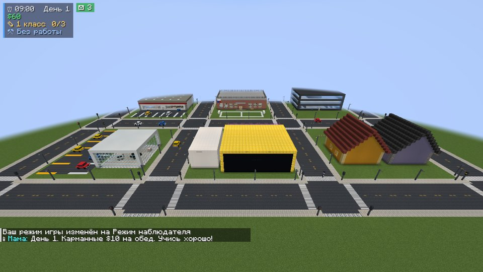

# LifeCraft — симулятор жизни для Minecraft Java

Мод для **Minecraft Java 1.21.1** на **Fabric**. Ты начинаешь в 1 классе школы, учишься, переходишь из класса в класс, поступаешь в вуз, работаешь и тратишь деньги на машины, технику и казино. Готовая карта города идёт в комплекте.

## Что есть

- **Школа и вуз.** Уроки у доски или у учителя: 5 вопросов на 20 секунд, в конце оценка от 2 до 5. Предметы: математика, русский, литература, английский, история, география, биология, физика, химия, информатика, а в вузе экономика, программирование и право. За 3 сданных урока переводят в следующий класс. После 11 класса дают аттестат, после 4 курса вуза — диплом. Уроки идут с 8:00 до 18:00, звонок звенит каждый час.
- **Телефон** (клавиша **G**). Выезжает снизу. На главном экране часы, баланс и 10 приложений: Банк (переводы друзьям, наличные), Школа (оценки, расписание), Работа (вакансии), СМС (пишут мама, школа, банк), Карта (вид сверху и цель задания), Магазин с доставкой, Казино, Музыка, Камера (снимок без интерфейса), Погода.
- **Работа.** Курьер разносит посылки по адресам. Кассир считает чеки на кассе. Таксист возит жителей на своей машине. Программист печатает код в офисе. Чем выше образование, тем больше платят.
- **Деньги.** Школьникам мама каждое утро даёт $10 карманных, взрослые платят $5 в день за ЖКХ. На бумажные деньги их меняет банкомат.
- **Машины.** 6 моделей, включая такси. Управление: W/S — газ и тормоз, A/D — руль, **H** — гудок. Колёса крутятся и поворачиваются, кузов кренится в поворотах, ночью горят фары и стоп-сигналы, из выхлопной трубы идёт дым, звук мотора меняется со скоростью. Сесть за руль своей машины может только её хозяин. Припаркованными машинами города может кататься любой.
- **Казино «Фортуна» (18+, только после школы).** Игровой автомат с крутящимися барабанами, рулетка с колесом и шариком. Деньги в казино только игровые.
- **Город.** Школа, супермаркет, офис с центром занятости, парк с фонтаном, казино, банк, автосалон со стоянкой такси и 6 домов с почтовыми ящиками. Есть дороги с разметкой, переходы, светофоры, которые переключаются по общим часам, и фонари. По улицам ходят жители: учителя, продавцы, школьники, рабочие, полицейский и бабушка.
- **Телевизоры** с 5 анимированными каналами: новости, мультики, природа, музыка и футбол.

| | |
|---|---|
|  |  |
|  |  |
|  |  |
|  |  |
|  |  |
|  |  |

## Установка по шагам

1. Установи **Fabric** для версии 1.21.1:
   - в официальном лаунчере — через установщик https://fabricmc.net/use/installer/ (выбери 1.21.1 и нажми «Установить»);
   - в TLauncher — просто выбери в списке версию **Fabric 1.21.1**.
2. Скачай **Fabric API** для 1.21.1: https://modrinth.com/mod/fabric-api/versions?g=1.21.1
3. Скачай мод: [`dist/lifecraft-0.1.0.jar`](dist/lifecraft-0.1.0.jar)
4. Положи оба файла (`fabric-api-….jar` и `lifecraft-0.1.0.jar`) в папку `mods`:
   - Windows: нажми Win+R, вставь `%appdata%\.minecraft\mods` и нажми Enter;
   - если папки `mods` нет, создай её.
5. Запусти игру с профилем **Fabric 1.21.1**.

### Как начать игру

- **Новый мир с городом.** «Одиночная игра» → «Создать мир» → «Другие настройки мира» → «Тип мира» → **LifeCraft: Город**. Город построится сам, а ты появишься перед школой.
- **Готовая карта.** Скачай [`dist/LifeCraft-Gorod-map.zip`](dist/LifeCraft-Gorod-map.zip) и распакуй в `%appdata%\.minecraft\saves`. Мир появится в списке как «LifeCraft Город».
- **Город в своём мире.** Команда `/lifecraft town` (нужны читы) строит город 160×160 вокруг игрока.

### Ресурспак

Ставить отдельно ничего не нужно: все текстуры, модели, звуки и переводы уже лежат внутри мода.

## Управление и команды

| Клавиша | Действие |
|---|---|
| G | Телефон |
| H | Гудок (в машине) |
| ПКМ по доске / учителю | Урок |
| ПКМ по парте | Сесть |
| ПКМ по ТВ | Следующий канал (присесть + ПКМ — выключить) |
| ПКМ по машине | Сесть (присесть + 3 удара по своей машине — забрать в инвентарь) |
| 1–4 на уроке | Выбрать ответ |

Команды: `/lifecraft info` — показать свои деньги и учёбу. Для админа: `/lifecraft town`, `/lifecraft money <игрок> <сумма>`, `/lifecraft edu <игрок> <1–16>` (1–11 — класс, 12–15 — курс вуза, 16 — диплом).

## Для разработчика

- Сборка: `./gradlew build` → `build/libs/lifecraft-*.jar`. Нужна Java 21.
- Текстуры и звуки рисует скрипт: `python3 tools/gen_assets.py`.
- Json-ресурсы (модели, переводы, звуки, мир) генерирует скрипт: `python3 tools/gen_resources.py`.
- Проверка без человека: `JAVA_TOOL_OPTIONS=-Dlifecraft.autotest=true xvfb-run ./gradlew runClient --args="--username Dev --quickPlaySingleplayer LifeCraftCity"`. Клиент сам обходит город, открывает экраны и сохраняет скриншоты в `run/screenshots`.
